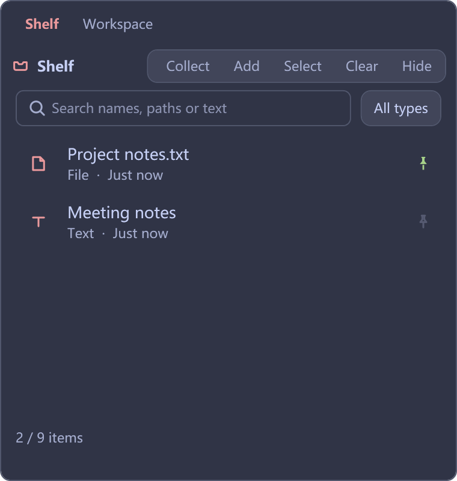

# Blossom Rest

[简体中文](README.md) | English

A small, always-on-top shelf for moving files, folders, text and images between Windows apps.

Drop items on the shelf, then copy or drag them to a chat, browser, editor or File Explorer. Files stay in their original location: Blossom Rest normally keeps a path reference rather than a content copy.

## Install and start

This is the **0.1.0 test build** for Windows 10 1809+ and Windows 11, x64.

- Installer: run `BlossomRest-0.1.0-win-x64-setup.exe`. It installs for the current user without administrator rights.
- Portable ZIP: extract the entire archive and run `TransitShelf.exe` inside `BlossomRest-win-x64`.
- The default packages include the .NET 10 LTS desktop runtime. You do not need to install .NET separately.
- Both languages use the same program and data. Open **Settings → Language** to choose **Follow system**, **简体中文** or **English**. Changes apply immediately and are saved.
- A new installation follows your Windows display language; a pre-existing state file without a language setting keeps Chinese.

The app runs in the system tray. Closing the panel keeps it running; use the tray menu to exit. Start with Windows is off by default. Release downloads belong on the project's [Releases page](https://github.com/Lzittle/BlossomRest/releases); read the release notes before installing a test build.

## Everyday use



| Action | Result |
| --- | --- |
| Drop files, folders, text or images | Add them to the current shelf or group |
| `Ctrl+Alt+C` | Collect the current clipboard content |
| `Ctrl+Alt+D` | Show or hide the panel |
| Click an item | Open folders; copy other items by default |
| Double-click | Open with the default app |
| Select several items, then Copy | Copy file paths and text together |
| Enable Workspace | Keep useful items in named groups indefinitely |

The shelf also supports search, type filters, image/video thumbnails, pinning, dark/light/system themes and optional folder watching. You can change the single-click action in Settings.

Chat apps may accept only one clipboard format per paste. Use **Copy text** for a second paste when needed. Rich-text apps such as Word, WPS and email editors can accept text with images together.

**Move to folder** changes the real file location after confirmation. Name conflicts get a number rather than overwriting a file. **Undo move** restores the most recent move during the current session. Folders cannot be moved between drives. **Suggest a name** only changes the display name on the shelf.

## Data and privacy

- No accounts, network requests or telemetry. Automatic collection is off by default.
- Removing items, clearing the shelf and expiry cleanup do not delete source files.
- Items, groups and settings are stored in `%LOCALAPPDATA%\TransitShelf\state.json`. Images without a source file are stored as PNGs in the adjacent `cache` folder.
- The portable package also uses this user data folder. Updating or uninstalling the program keeps it.
- File names, group names, paths and text you enter are never translated when you change the interface language.
- The app does not automate WeChat or other apps and never sends messages for you.

## Current limits

This test build is unsigned. First launch has taken about 2 seconds in testing, above the 1.5-second target. Multi-monitor placement, 125%/150%/200% scaling, input-method focus and cross-app delivery still need broader hands-on testing. Video thumbnails depend on Windows codecs. The app has no online updater.

See the [user guide](docs/USER-GUIDE.en.md) and [release notes](docs/RELEASE-NOTES.en.md).

## Build from source

Windows and the .NET 10 SDK specified in `global.json` are required. Run `.\scripts\install-sdk.ps1` to install a verified SDK inside the repository, or use a matching system SDK. This project uses C# and WPF, with no web UI shell.

```powershell
.\scripts\dev.ps1 build -c Release
.\scripts\dev.ps1 test -c Release
.\scripts\run.ps1
.\scripts\publish.ps1
```

The publish script creates a new output folder, a portable ZIP and a SHA-256 file. To build the bilingual installer, supply an Inno Setup 6 compiler:

```powershell
.\scripts\build-installer.ps1 -PublishRoot <publish-output> -Compiler <ISCC.exe-path>
```

Acceptance tests use isolated data. Some checks temporarily use the clipboard or mouse, so pause desktop interaction while they run.

The bilingual UI check runs the program's own button events without moving the mouse. It uses isolated sample data and temporarily uses the clipboard:
Save anything you currently have copied before running it.

```powershell
.\scripts\dev.ps1 run -c Release --project scripts/verification/LocalizationUiHarness
```

## License

[MIT](LICENSE). Bundled .NET runtime components include their own license and third-party notices.
